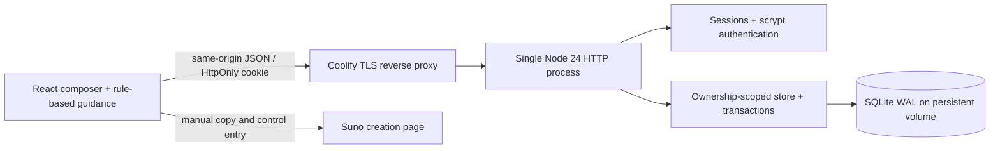

# Sunomat project specification

Status: implemented application; see `implementationplan.md` for verified checks and remaining deployment checks. Research date: 2026-10-31.

## Purpose

Make deliberate Suno production easier: describe a sound, prepare original lyrics, record the exact settings and references, copy them into Suno, then keep successful combinations and the history that led to them. A guest can use the entire editor and guidance. An authenticated user can store and retrieve only their own library.

Sunomat is independent of Suno. It does not generate songs, authenticate with Suno, upload reference media, estimate credit costs, guarantee deterministic audio or enforce subscription rights. The operator deploys it with Docker Compose on Coolify, using one persistent SQLite database.

## Research and design decisions

### Primary workflow guide

[Sonoya: Suno v6 guide (original article in German)](https://sonoya.com/suno-v6-anleitung-eigene-songs-mit-ki-erstellen/) was retrieved directly as HTTP 200 on 2026-10-31 after the search tool could not open it. Recommendations are paraphrased and original examples are used; no article or lyric examples are reproduced.

The guidance engine uses concise sound descriptions, positive wanted elements in Style and unwanted elements in Exclude, square-bracket section cues, short lyric lines, and one-variable iteration. Those are practical recommendations rather than a formal prompt grammar. Advice remains visible but does not block saving an incomplete idea. Schema limits and valid types do block malformed storage.

### Official controls and availability

- [v6 FAQ](https://help.suno.com/en/articles/13924481): Variety can adjust style prompts; 0 is useful for retaining entered tags. Max Mode is useful for longer tracks, close covers and consistency, at additional cost. This is guidance rather than automatic selection.
- [What's new in v6](https://help.suno.com/en/articles/13924801): v6, v6-wild, v6-mini, up to eight minutes; access varies by plan. The UI records a custom model name as well.
- [Creative sliders](https://help.suno.com/en/articles/6141377): Weirdness, Style Influence, and conditional Audio Influence. Weirdness 50% is normal, not a recommended universal optimum.
- [Custom Mode](https://help.suno.com/en/articles/3726721): lyrics/instrumental, styles, advanced options and title.

The app's core is Custom Mode. Simple Mode is also supported with a full prompt and model selection; switching modes retains entered fields but only the applicable fields appear in handoff. Persona, voice and My Taste are explicitly recorded context, selected manually in Suno. Source notes represent text/audio/image/video references; media itself is attached in Suno.

Style 1,000 and Lyrics 5,000 character caps follow the supplied guide's reported interface, not a published API contract. Exclude has an application safety allowance of 1,000, not a verified Suno UI limit. Title is capped locally at 120. Recheck these when Suno changes. Duration/BPM/key/language are **planning metadata**, not native controls guaranteed by Suno. Tempo/key can be explicitly appended to Style.

### Comparable composer patterns

No defensible traffic ranking was available, so these are established publicly discoverable comparables, not a claim that they are the most popular.

- [Suno Prompt Builder](https://sunobuilder.com/): grouped sound inputs, reusable presets, preview, copy/export and responsive editing. Adopted those workflow patterns; omitted AI refinement, batch generation, community sharing and DAW timelines to keep the app small. Source summary: its public page describes a structured brief plus local history/presets and export formats.
- [Suno Prompt Manager](https://usesuno.com/extensions/suno-prompt-manager/): private prompt storage, search and structured sound dimensions. Adopted private searchable projects and tag dimensions. The product describes this workflow in its own documentation; no browser-extension integration is implemented here.
- [Styles Prompt Master guide](https://stylespromptmaster.com/guide): presets and a prompt vault emphasize recall and reuse. Search results exposed this description, but the page had no readable content; it was not used to assert detailed feature behavior.

The differentiator here is complete setting snapshots, immutable revisions, result ratings and explicit one-change production notes. No external AI request is made for advice, keeping deployment inexpensive and private.

### English-language contract

All application-owned labels, hints, guidance, validation, notifications, exports and documentation use English. `shared/presentation.ts` fixes dates and numbers to `en-US` instead of inheriting the browser language, while retaining the user's local time zone. Field labels cover every schema field, including guidance filters and version comparison. Shared account validation avoids localized native-browser validation bubbles, and controlled import/connection messages avoid exposing localized browser exception text. User-authored song content is preserved verbatim, including Unicode and non-English lyrics; source URLs and standard genre names remain unchanged. Browser/operating-system chrome such as the file picker and standard page-unload confirmation is outside the application's language control.

## Experience and visual system

Black/white/neutral palette with light and dark themes. The UI uses locally owned shadcn/ui-style Button, Input, Textarea, Card, Badge and accessible Radix Dialog primitives, Tailwind 4, CVA and class merging. A quiet typographic hierarchy, consistent borders, compact badges and a CSS record illustration reinforce a music workspace without asset downloads or external fonts.

Desktop: persistent workspace navigation; four editing sections; a live song preview and coaching column. Tablet: preview/coaching move below the editor. Mobile: compact sticky navigation, stacked cards and touch-friendly controls. Labels, focus indicators, keyboard-operable tabs, dialog focus trapping, visible errors and live notifications support accessible use. Dark/light follows OS on first use and stores only the theme preference locally.

### Composer fields

| Group       | Fields / behavior                                                                                          |
| ----------- | ---------------------------------------------------------------------------------------------------------- |
| Identity    | Title, Custom/Simple mode, v6/v6-wild/v6-mini/custom model and custom model name                           |
| Sound       | Editable Style, categorized searchable toggle tags, Exclude, original starter presets                      |
| Words       | Original lyrics, cursor-position section tag insertion, instrumental, vocal gender, lyric language         |
| Controls    | Weirdness, Style Influence, Variety, Max Mode, Audio Influence only when audio is selected                 |
| Context     | Reference notes, persona, voice, My Taste, target duration, tempo, key/time signature                      |
| Production  | Idea/draft/testing/finished, song/template, change note, listening notes, result URL, 0–5 rating, favorite |
| Portability | Per-field copy, handoff field copy, full checklist copy, TXT export, complete JSON export/import           |

Character counters and schema contracts guard the major text limits. Cross-field rules catch unwanted elements in Style, repeated descriptors, conflicting exclusions, vocal/instrumental conflicts, missing structure, unbalanced brackets, likely sung instructions, overloaded prompts and missing repeatability notes. The guide screen shows all advice; the composer shows four focused entries with a field filter. Warnings are advisory, not scored predictions.

### Guest and identity behavior

Guests can edit, use presets, review coaching, copy and export/import. The private library endpoints require a valid session and enforce ownership. The library page gives guests a sign-in prompt, never server data. Account creation takes email and a minimum 12-character password. Email addresses are not verified; there is no email provider or email recovery flow. Operator-assisted recovery is documented separately.

Drafts live in React memory. Navigation that replaces a dirty draft prompts for export, continuing to edit or discarding; page unload uses the browser's standard unsaved-changes warning. Explicit save is available for partial drafts. No hidden autosaving consumes the quota. Signing out clears private records and the editor in memory. No lyrics, account tokens or saved projects enter localStorage.

Library and history loads carry a request generation; saves, deletions and account-status requests also track the current account generation. Signing out or signing into another account invalidates older generations and clears cached projects and private dialogs. A delayed response from an earlier account, or from an outdated refresh, cannot replace the current account's projects, active song, quota, errors or loading state. Browser regression tests deliberately hold one account's library, history and save responses until after a second account signs in. A save already authorized by the server can still complete for its original owner; its delayed response is simply prevented from changing another user's interface.

## Architecture

React/TypeScript/Vite build to static assets. Node's HTTP server serves both assets and API; the only required runtime library is Zod (frontend libraries are also left in the production install for a simple reproducible dependency graph). Node's built-in SQLite avoids native addons and an extra database service. `esbuild` bundles server source; production does not run TypeScript tooling. No ORM, Redis, queue, external model, analytics or telemetry.

### Code boundaries

- `shared/song.ts`: single schema, defaults, tags, original presets, deterministic advice and text handoff.
- `shared/presentation.ts`: exhaustive English field labels, date/number formatting and pure snapshot comparison.
- `shared/setup.ts` and `shared/identity.ts`: validated setup imports, readable validation errors and shared account credential rules.
- `server/store.ts`: versioned DB migration, ownership checks, immutable saves, quota and optimistic conflict checks.
- `server/app.ts`: HTTP routing, auth, sessions, validation, rate limits, security headers, static files.
- `server/index.ts`: environment validation and graceful shutdown.
- `src/components/ui/primitives.tsx`: locally owned shadcn composition and Radix dialog behavior.
- `src/components/version-comparison.tsx`: read-only side-by-side changes between an earlier saved version and the latest snapshot.
- `src/App.tsx`: composer/library/guide workflows. Render helpers are invoked as functions to avoid remounting input components on keystrokes.
- `src/api.ts`: same-origin fetch and downloadable exports.
- `tests/`: real HTTP/SQLite integration tests and guidance contracts.

### Data model and saving

`users(id, email UNIQUE, password, created_at)`; `sessions(token_hash, user_id, expires_at)`; `projects(id, user_id, name UNIQUE)`; `saves(id, project_id, user_id, content JSON, created_at)`.

Every successful save inserts one snapshot. Existing snapshots are never updated. A project groups revisions and retains a stable name from its initial title, ASCII-normalized slug plus full UUID. Display title can change in later snapshots. The revision's JSON includes all editor values and production notes.

The quota is **100 snapshots per user across songs/templates**, not 100 projects plus unlimited history. `BEGIN IMMEDIATE` plus a database trigger ensures the final slot cannot be taken twice. An ownership trigger prevents inconsistent project/user associations. Foreign keys cascade project deletion. Deleting the last snapshot removes the empty project. Latest versions are ordered by insertion rowid, not wall-clock precision. Lists return only the latest snapshot and version count; history returns all retained snapshots for that owner.

To update a project, the client submits the latest known `baseId`. An outdated base gives 409, preserving the local draft. Loading an old snapshot records the current latest base; a subsequent save inserts a new latest snapshot without mutating its source. Using any project as a template starts a detached song, retains sound/context and lyrics, and clears outcome-specific title, rating, favorite, result link and listening notes.

Version history also offers a read-only comparison of any earlier snapshot with the latest saved version. The comparison lists only fields whose stored values differ, including lyrics and listening notes. Values have English labels and appropriate units; empty values and unrated results are explicit. Identical snapshots have an empty-state explanation. The comparison is computed from already owner-scoped history in the browser: no additional database writes, API endpoints, migrations or quota usage are introduced. On mobile, the earlier/latest values stack vertically.

### API

| Method/path                        | Contract                                               |
| ---------------------------------- | ------------------------------------------------------ |
| GET `/api/health`                  | Lightweight SQLite read check, no account data         |
| GET `/api/me`                      | Current user or null, quota usage, registration state  |
| POST `/api/register`, `/api/login` | Validated credentials, new opaque session cookie       |
| POST `/api/logout`                 | Invalidate current session and expire cookie           |
| GET `/api/projects`                | Owner's latest snapshots, counts and usage             |
| GET `/api/projects/:uuid`          | Owner-scoped complete revision history                 |
| POST `/api/saves`                  | `{song, projectId?, baseId?}`; immutable save or 409   |
| DELETE `/api/projects/:uuid`       | Delete owner-scoped project and all revisions          |
| DELETE `/api/saves/:uuid`          | Delete one owner-scoped revision; remove empty project |

JSON mutations require exact configured Origin plus `X-Sunomat-Request: 1`. JSON body cap is 80 KB; both frontend import and backend schema validate. Bad input → 400, missing session → 401, cross-origin → 403, missing or another owner's resource → 404, full quota/conflict → 409, wrong content type → 415, throttling → 429. Error responses expose no SQL or passwords.

### Security and privacy

Passwords use Node scrypt with random 128-bit salts and constant-time comparison; only salted hashes are stored. Sessions use random 256-bit tokens, storing only SHA-256 hashes, expire after seven days and are pruned. Login replaces that browser's session and caps active sessions per account. Production cookies are `__Host-`, Secure, HttpOnly, SameSite=Lax. Production startup requires an exact HTTPS APP_ORIGIN. CORS is not enabled; mutations compare Origin and reject cross-site Fetch Metadata. Forwarded Host/IP headers are not trusted.

Bounded in-memory login/register throttles apply by normalized email and socket IP; at most eight simultaneous password operations. Behind Coolify the IP allowance is shared, so internet-facing operators should also configure edge throttling. The rate map is capped and pruned. SQL uses bound parameters. React escapes user content. No uploaded HTML, arbitrary file access, URL fetching or outbound AI API exists. Production headers include CSP, anti-framing, HSTS, no-sniff and permissions policy. API responses are never cached. Operator access to the database implies access to account metadata and lyrics; disk encryption/backups are operator responsibilities.

## Deployment and resource policy

One Node 24 container and one persistent volume. Multi-stage Debian slim image; non-root runtime; readonly root; tmpfs `/tmp`; Linux capabilities dropped; no-new-privileges. Compose sets 384 MB memory and 1 CPU limits with bounded logs. TLS terminates at Coolify and forwards to port 3000; no direct host publication. Use one replica and local storage, not network-shared SQLite. Built-in SQLite WAL, busy timeout, indexes and short write transactions support modest multi-user usage. No claim of large-scale concurrency or guaranteed minimum RAM is made.

Database migration version is stored in `PRAGMA user_version`; migration 1 is transactional. A newer unknown schema is rejected rather than silently downgraded. Snapshot schemas remain backwards-compatible via field defaults; future breaking changes require explicit migrations. Back up before upgrades. Image tags are Node LTS major tags; npm dependencies are locked. Rebuild regularly to pick up security updates and review the lockfile deliberately.

## Acceptance criteria

- Guest editor and advice work; private retrieval is rejected without authentication.
- User A cannot list, open, change or delete user B's records, including guessed UUIDs.
- Incomplete drafts save; malformed values do not. Unique stable names survive display-title changes.
- Every save retains prior snapshots, quota cannot exceed 100 under simultaneous requests, and stale updates cannot silently win.
- Reusing a template detaches its history. A source project stays unchanged.
- All fields are copyable or included in full JSON/TXT handoff as appropriate; instrumentals do not copy retained sung lyrics.
- Theme, keyboard navigation and layout work at desktop and mobile widths.
- Production build, API tests, container health and volume persistence are checked when runtime capabilities permit.

## Known boundaries and future extensions

No public sharing or admin dashboard; no verified-email service, self-service password reset, OAuth/SSO or MFA. This is a modest self-hosted account system; use edge controls and operator recovery. No audio storage, direct Suno integration, automated syllable analysis, full-text search index, autosave or exact output reproduction. Field recommendations can have false positives; users remain free to save. Locale is English. Import/export is per setup; bulk user-library export and account deletion are future work. For high-volume/multi-host usage, migrate to a network database and shared rate limiter before adding replicas.
